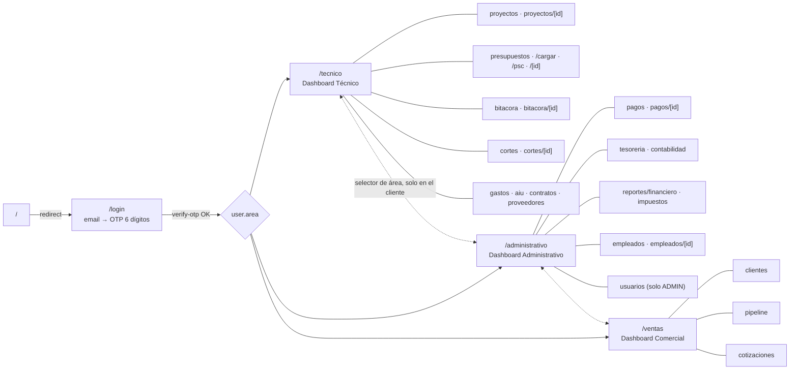
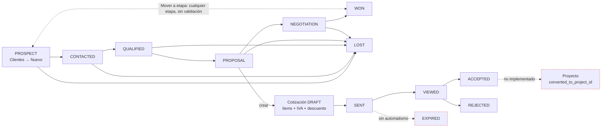

# Control de Obra Pro — Documentación técnica y plan de mejoras

1 oct 2026 · Nelson Rozo · Versión colaborativa: https://claude.ai/code/artifact/2cb12dc2-9be4-44ec-b268-7d6b7c28e631

Control de Obra Pro es un monolito Next.js 15 sobre MySQL, con flujos de aprobación bien modelados en el servidor. Sus mayores riesgos son tres: el OTP puede devolverse en la respuesta en producción, cualquier usuario autenticado lee los datos bancarios de todos los pagos y dos fallos de UI bloquean flujos reales (reenviar un corte rechazado y confirmar acciones en el detalle de pago).

**Alcance.** Se leyó el código de `ControlObra/nextjs_space/src`: 34 rutas de página, 30 rutas API, `lib/` (workflows, auth, stores), `types/index.ts` y el esquema `database/mysql/init.sql`. Las conclusiones se basan solo en ese código. Lo que no aparece en él se marca como *No visible en el código*. Las referencias usan el formato `archivo:línea`.

## 1. Stack tecnológico y arquitectura

Es una sola aplicación Next.js: las páginas (cliente) y las rutas API (servidor Node) viven en el mismo repositorio y hablan con MySQL mediante SQL escrito a mano, sin ORM.

| Capa | Tecnología | Evidencia |
| --- | --- | --- |
| Frontend | React 19 + Next.js 15.5 (App Router), todas las páginas `"use client"` | `package.json`, `app/*/page.tsx` |
| UI | Tailwind 3, componentes Radix (estilo shadcn), iconos lucide | `components/ui/*` |
| Estado cliente | Zustand 5 (sin persistencia local; MySQL es la fuente de verdad) | `lib/data-store.ts`, `lib/store-factory.ts` |
| Formularios | react-hook-form + Zod 4 | `components/payments/payment-form.tsx` |
| Backend | Route Handlers de Next (`app/api/**/route.ts`), runtime Node | 30 archivos `route.ts` |
| Base de datos | MySQL vía `mysql2/promise`, pool singleton, transacciones manuales | `lib/db.ts`, `database/mysql/init.sql` |
| Autenticación | OTP de 6 dígitos por correo (nodemailer) + cookie `co_session` firmada con HMAC-SHA256 | `api/auth/*`, `lib/session.ts` |
| Documentos | docxtemplater + xlsx sobre plantillas oficiales; integración SharePoint (MS Graph / MSAL) | `lib/document-generator/*`, `lib/sharepoint/*` |
| Pruebas | Vitest + Testing Library (32 specs en `tests/verifiers`) | `vitest.config.mjs` |
| Despliegue | Hostinger (variables `DATABASE_URL` o `DB_*`) | `.env.hostinger.example`, `lib/db.ts` |

### Estructura de carpetas

- `src/app/{tecnico,administrativo,ventas}/` — una carpeta por área; cada una tiene `layout.tsx` que envuelve con `DashboardShell` (sidebar + header).
- `src/app/api/<recurso>/route.ts` — un archivo por recurso con `GET/POST/PUT/DELETE` y, en cortes, pagos y presupuestos, `PATCH` para acciones de workflow.
- `src/lib/` — lógica pura reutilizable (`*-workflow.ts`, `*-constants.ts`, `*-validation.ts`), acceso a datos (`db.ts`), autenticación (`api-auth.ts`, `session.ts`) y stores.
- `src/components/<módulo>/` — formularios por entidad (`cut-form`, `payment-form`, `project-form`…).
- `src/mocks/` — datos de ejemplo heredados de la fase sin backend.

### Flujo de datos

1. La página llama un hook de store (`usePaymentsStore()`), que ejecuta `load()` → `api.get('/api/payments')`.
2. `lib/api.ts` hace `fetch` con JSON y convierte cualquier respuesta no 2xx en `ApiError` con el mensaje del backend.
3. La ruta API valida la sesión (`requireAuth` / `requireRole` / `requireAdmin`), consulta MySQL y devuelve un DTO en camelCase.
4. Tras una mutación, el store vuelve a pedir la lista completa (no hay actualización optimista).
5. Los KPIs de los tres dashboards salen de un solo endpoint, `GET /api/dashboard/stats`, que agrega en memoria (`lib/dashboard-stats-compute.ts`).

### Roles (actores)

El tipo `Role` (`types/index.ts:4`) y el ENUM de `users.role` definen 9 roles. **No existe un rol de Ventas/Comercial**: el área comercial la operan los mismos roles internos.

| Rol | Qué puede hacer según el código |
| --- | --- |
| ADMIN | Todo. Único que elimina registros y gestiona usuarios. Aprueba cortes (APPROVE) y puede ejecutar cualquier acción de pago. |
| DIRECTOR | Aprobación nivel 1 de pagos; envía y valida cortes; rechaza pagos y cortes. |
| GERENTE | Aprobación nivel 2 de pagos; rechaza pagos y cortes. |
| TESORERIA | Marca pagos y cortes como pagados; cancela pagos. |
| RESIDENTE | Envía cortes a validación; crea bitácoras, cortes y solicitudes de pago. |
| CONTABILIDAD, HSEQ | Crean y editan la mayoría de entidades (misma lista blanca de 7 roles), sin acciones de workflow. |
| CLIENTE, USER | Solo lectura: pasan `requireAuth` en los GET, pero ninguna escritura los incluye. |

Además del rol, cada usuario tiene un `area` (`tecnico`, `administrativo`, `ventas`) y un `status` (`PENDING`, `ACTIVE`, `SUSPENDED`). Solo `ACTIVE` puede iniciar sesión. El área **no restringe nada**: el selector de área del sidebar la cambia solo en el cliente (`auth-store.ts:832`).

## 2. Procesos, entradas, salidas y reglas de negocio

Las reglas de los flujos con aprobación (pagos, cortes) se aplican en el servidor mediante funciones puras y probadas. En el área comercial, en cambio, las reglas solo existen como texto de ayuda: el servidor acepta cualquier cambio de estado.

### Módulo Administrativo

| Proceso | Entradas (payload) | Salidas | Reglas de negocio en código |
| --- | --- | --- | --- |
| Crear solicitud de pago `POST /api/payments` | Obligatorios: `projectId`, `amount`, `type`, `beneficiaryName`, `beneficiaryNit`. Opcionales: `providerId`, `workCutId`, `priority`, `bankName`, `accountType`, `accountNumber`, `dueDate`, `description`, `requiredApprovalLevel` (1 o 2, por defecto 1) | 201 + `requestNumber` `PAG-AAAA-XXXXX`; estado `PENDING`, nivel actual 0; `created_by` sale de la sesión | Escriben 7 roles (todos menos CLIENTE y USER). `requiredApprovalLevel` ∉ {1,2} → 400. |
| Editar solicitud `PUT /api/payments` | Mismos campos, parciales | `{ok:true}` | Solo si `status = PENDING` → si no, 409 `PAYMENT_NOT_EDITABLE` (`payments-workflow.ts:208`). |
| Aprobar / rechazar / pagar / cancelar `PATCH /api/payments` | `id`, `action` (`APPROVE_L1`, `APPROVE_L2`, `PAY`, `REJECT`, `CANCEL`), `comments`, `rejectionReason`, `paymentReference`, `paymentMethod` | Nuevo `status` + fila en `payment_approvals` (usuario, rol, nivel, referencia), en una transacción | Roles: L1 = DIRECTOR/ADMIN; L2 = GERENTE/ADMIN; PAY y CANCEL = TESORERIA/ADMIN; REJECT = DIRECTOR/GERENTE/ADMIN. Rechazo sin motivo → 400. L1 solo con nivel actual 0. L2 prohibido si la solicitud exige 1 nivel. Con 1 nivel, L1 salta directo a `APPROVED`. `REJECTED`, `PAID` y `CANCELLED` son finales. |
| Eliminar solicitud `DELETE` | `id` | `{ok:true}` | Solo ADMIN y solo en `PENDING`, `CANCELLED` o `REJECTED`. |
| Contabilidad (ingresos, gastos, cuentas, metas, movimientos de impuestos) | Formularios en `components/accounting/*` | Listas y totales | Escritura limitada a `ACCOUNTING_WRITE_ROLES`; borrado solo ADMIN. |
| Usuarios y autorizaciones `/api/users` | email, nombre, rol, área, estado | Alta en `users` con estado `PENDING`/`ACTIVE` | Todo el recurso exige ADMIN. |
| Dashboard administrativo | `GET /api/dashboard/stats` + pagos + proyectos | KPIs: Por pagar, Total ejecutado, Retención estimada, Empleados activos | Retención = 10 % fijo sobre lo ejecutado e IVA = 19 % fijo, calculados en la página (`administrativo/page.tsx:69-70`), no en Impuestos. |

### Módulo Técnico

| Proceso | Entradas (payload) | Salidas | Reglas de negocio en código |
| --- | --- | --- | --- |
| Crear / editar proyecto `/api/projects` | código, nombre, cliente, ubicación, `totalBudget`, `executedAmount`, estado, descripción | Proyecto en `IN_PLANNING` por defecto | POST/PUT: ADMIN, GERENTE, DIRECTOR, RESIDENTE. DELETE: ADMIN, sin validar dependencias; borra en cascada cortes, pagos y bitácoras (FK `ON DELETE CASCADE`). `executedAmount` se escribe a mano; nada lo calcula. |
| Bitácora diaria `POST /api/work-logs` | Obligatorios: `projectId`, `date`, `weather`, `activities`. Opcionales: temperatura, trabajadores, incidentes, materiales, observaciones | Registro en `work_logs` | Una bitácora por proyecto y fecha (índice único → 409). `created_by` y `created_by_name` salen del body, no de la sesión (`work-logs/route.ts:73`). |
| Crear corte `POST /api/cuts` | Obligatorios: `projectId`, `providerId`, `description`, `periodStart`, `periodEnd`. Además: `items[]` (cantidad, precio unitario, código de ítem), `retentionPercent`, `advanceDeduction` | Corte `DRAFT`, número `CO-XXXXXX`, totales calculados | El servidor recalcula bruto, retención y neto con `computeCutTotals`; nunca confía en los totales del navegador. FK inexistente → 400. |
| Editar corte `PUT /api/cuts` | Mismos campos, `items` completos | Totales recalculados; los ítems se reemplazan | Solo en `DRAFT` o `REJECTED` → si no, 409 `CUT_NOT_EDITABLE`. El estado no se acepta del body. |
| Workflow de corte `PATCH /api/cuts` | `id`, `action` (`SUBMIT`, `VALIDATE`, `APPROVE`, `REJECT`, `PAY`), `comments`, `rejectionReason` | Nuevo estado + sello de tiempo (`submitted_at`, etc.) + fila en `work_cut_approvals` | SUBMIT: RESIDENTE/DIRECTOR/ADMIN. VALIDATE: DIRECTOR/ADMIN. APPROVE: solo ADMIN. REJECT: ADMIN/DIRECTOR/GERENTE, con motivo obligatorio. PAY: TESORERIA/ADMIN. Transiciones en `cuts-workflow.ts:16`. |
| Eliminar corte `DELETE` | `id` | `{ok:true}` | Solo ADMIN y solo en `DRAFT` o `REJECTED`. El tip del dashboard no dice que solo ADMIN puede hacerlo. |
| Presupuestos, PSC, AIU, contratos, proveedores, gastos | Formularios por entidad; carga de presupuesto desde Excel (`excel-parser.ts`) | CRUD + órdenes de cambio de presupuesto | NIT de proveedor único; control de cambios en `budget-change-control.ts`. Fuera del foco de los tres dashboards. |
| Generar documentos `POST /api/documents/generate` | Tipo de formato + entidad | Archivo DOCX/XLSX (anticipo, corte, OC, OS, contratos, legalización, ausencia) y registro en log | Requiere sesión; plantillas en `formatos-snapshots/`. |

### Módulo Comercial

| Proceso | Entradas (payload) | Salidas | Reglas de negocio en código |
| --- | --- | --- | --- |
| Crear prospecto `POST /api/clients` | Obligatorios: `companyName`, `contactName`, `email`, `phone`, `city`, `source` (REFERIDO, WEB, REDES_SOCIALES, FERIA, LLAMADA_FRIA, OTROS). Opcionales: NIT, sector, notas, `status` | Cliente `CLI-XXXXXX` en `PROSPECT` por defecto | Escriben 7 roles; no hay rol comercial. El email no se valida en el servidor. |
| Mover en el pipeline `PUT /api/clients` (`status`) | `id`, `status` | `{ok:true}` | **Ninguna.** La guía dice “solo se puede avanzar”, pero el modal “Mover a etapa” (`ventas/pipeline/page.tsx:287`) permite cualquier etapa y el servidor acepta cualquier valor. No queda historial de etapas. |
| Crear cotización `POST /api/quotations` | Obligatorios: `clientId`, `title`, `validUntil`. Además: `items[]`, `subtotal`, `discountPercent`, `discountAmount`, `ivaPercent` (19 por defecto en el formulario), `ivaAmount`, `total`, condiciones de pago, entrega y garantía | Cotización `COT-XXXXXX` en `DRAFT` | Los totales e ítems se guardan tal como llegan del navegador; el servidor no los recalcula. `created_by` sale del body. |
| Cambiar estado de cotización `PUT` | `status` (DRAFT, SENT, VIEWED, ACCEPTED, REJECTED, EXPIRED, CANCELLED) | `{ok:true}` | Sin máquina de estados ni vencimiento automático. `converted_to_project_id` existe en la tabla pero ningún código lo escribe (“futuro” en la guía). |
| Dashboard comercial | stats + clientes + cotizaciones | Clientes totales, ganados, % de conversión, valor abierto; embudo de 6 etapas (sin `LOST`) | La conversión = WON / todos los clientes, incluidos los perdidos y los recién creados. |

## 3. Diagramas

Los cuatro diagramas salen de las rutas y de las tablas de transición del código. Las líneas punteadas o en rojo marcan comportamientos rotos, sin control o no implementados (ver Sección 4). Los bloques se pueden copiar tal cual a un README o a mermaid.live.

### 3.1 Navegación general (rutas)

Tras el OTP, el usuario aterriza en el dashboard de su `area` (`login/page.tsx:100`). El selector del sidebar permite saltar a cualquier área sin restricción.



### 3.2 Flujo de pagos (Dashboard Administrativo)

Con 1 nivel, la aprobación del Director lleva directo a `APPROVED`. Con 2 niveles, el Gerente aprueba después. El estado `APPROVED_LEVEL_2` existe en la base de datos, pero ninguna acción lo alcanza.

```mermaid
stateDiagram-v2
  [*] --> PENDING: POST /api/payments<br/>(7 roles; created_by = sesión)
  PENDING --> APPROVED: APPROVE_L1 · DIRECTOR/ADMIN<br/>si required_level = 1
  PENDING --> APPROVED_LEVEL_1: APPROVE_L1 · DIRECTOR/ADMIN<br/>si required_level = 2
  APPROVED_LEVEL_1 --> APPROVED: APPROVE_L2 · GERENTE/ADMIN
  APPROVED --> PAID: PAY · TESORERIA/ADMIN<br/>(referencia y método opcionales)
  PENDING --> REJECTED: REJECT + motivo
  APPROVED_LEVEL_1 --> REJECTED: REJECT + motivo
  PENDING --> CANCELLED: CANCEL · TESORERIA/ADMIN
  APPROVED_LEVEL_1 --> CANCELLED: CANCEL
  APPROVED --> CANCELLED: CANCEL (la UI no lo ofrece)
  APPROVED_LEVEL_2 --> APPROVED: inalcanzable
  REJECTED --> [*]: final, crear nueva solicitud
  PAID --> [*]
  CANCELLED --> [*]
  note right of PENDING
    Único estado editable (PUT).
    Cada acción inserta una fila en payment_approvals.
  end note
```



### 3.3 Pipeline comercial (Dashboard Comercial)

El flujo diseñado (línea continua) avanza de PROSPECT a WON. El código real (línea punteada) permite saltar a cualquier etapa, también hacia atrás. La conversión a proyecto no está implementada.



### 3.4 Flujo técnico: proyecto → bitácora → corte → pago

La bitácora y el corte no están conectados en el código: el corte se crea por separado, con sus propios ítems. El corte y la solicitud de pago tienen cada uno su acción PAY independiente.

```mermaid
flowchart TD
  PJ["Proyecto<br/>POST /api/projects<br/>IN_PLANNING → IN_EXECUTION"] --> BL["Bitácora diaria<br/>1 por proyecto y fecha"]
  PJ --> D["Corte DRAFT<br/>ítems, retención %, anticipo<br/>totales calculados en servidor"]
  BL -.->|sin vínculo en código| D
  D -->|SUBMIT · RESIDENTE/DIRECTOR/ADMIN| S[SUBMITTED]
  S -->|VALIDATE · DIRECTOR/ADMIN| VA[VALIDATED]
  VA -->|APPROVE · solo ADMIN| AP[APPROVED]
  S -->|REJECT + motivo| RJ[REJECTED]
  VA -->|REJECT + motivo| RJ
  RJ -->|editar| RJ
  RJ -.->|"Reenviar": 400 INVALID_TRANSITION| S
  AP -->|PAY · TESORERIA/ADMIN| CP[Corte PAID]
  AP -->|"Pagos → Nueva" con workCutId<br/>monto = neto (solo en la UI)| PR[Solicitud de pago PENDING]
  PR --> FL["Flujo de pagos (3.2)"] --> PP[Pago PAID]
  PP -.->|no sincroniza| CP
  classDef broken stroke:#d33,stroke-width:2px
  class RJ broken
```

## 4. Auditoría de código y UX/UI

Hay que corregir primero cuatro P0: el OTP expuesto, la lectura abierta de datos bancarios, el bloqueo de cortes rechazados y el borrado en cascada de pagos al eliminar un proyecto. Los workflows de pagos y cortes son la parte más sólida del sistema (funciones puras, transacciones, bitácora de aprobaciones, tests). Lo más débil es el área comercial, que no tiene reglas en el servidor.

Prioridad: **P0** = riesgo de seguridad o flujo bloqueado, corregir ya; **P1** = integridad de datos o error visible al usuario; **P2** = mejora.

### 4.1 Lógica y validaciones

| Prioridad | Hallazgo | Evidencia | Recomendación |
| --- | --- | --- | --- |
| P0 | Un corte rechazado no puede reenviarse. La UI ofrece “Reenviar” (SUBMIT), pero `REJECTED` solo admite pasar a `DRAFT` y ninguna acción lleva a `DRAFT`, así que el servidor responde 400 `INVALID_TRANSITION`. | `cuts-workflow.ts:21`, `cuts-constants.ts:45` | Cambiar a `REJECTED: ["SUBMITTED"]` o crear la acción `REOPEN` → `DRAFT`. Revisar `workcut-reject-transition.spec.ts`, que fija el comportamiento actual. |
| P1 | El detalle de pago muestra “Error desconocido” aunque la acción sí se aplicó: `performAction` devuelve una promesa que no se espera, y `result.ok` es `undefined`. El usuario reintenta y recibe un error de transición. | `administrativo/pagos/[id]/page.tsx:127-140` | Declarar `handleAction` como `async` y usar `await performAction(...)`; deshabilitar el botón mientras se procesa. |
| P1 | Condición de carrera en aprobaciones: el estado se lee y luego se actualiza sin bloqueo. Dos aprobadores simultáneos pasan ambos la validación. | `api/payments/route.ts` PATCH, `api/cuts/route.ts` PATCH | `UPDATE … WHERE id = ? AND status = ?` y comprobar `affectedRows = 1`, o `SELECT … FOR UPDATE` dentro de la transacción. |
| P1 | El pago no exige referencia ni método. La guía dice que Tesorería los registra, pero el servidor acepta `PAY` sin ellos. | `payments-workflow.ts:119` | Si `action = PAY`, exigir `paymentReference` y `paymentMethod` ∈ {TRANSFER, CHECK, CASH}. |
| P1 | Corte y pago no están enlazados. La solicitud acepta cualquier `workCutId` (solo la UI filtra los cortes `APPROVED`), no valida el monto contra `net_value`, permite varias solicitudes por corte, y marcar el pago `PAID` no marca el corte. Hay dos acciones PAY independientes. | `api/payments/route.ts:67-110`, `payment-form.tsx:197` | En el servidor: corte `APPROVED`, monto ≤ neto, una solicitud activa por corte. Al pagar la solicitud, pasar el corte a `PAID` en la misma transacción y quitar el PAY manual del corte. |
| P1 | Las guías se contradicen con el código: el dashboard técnico dice “cuando un Corte está Validado, Tesorería inicia el pago”, pero falta un paso `APPROVE` que solo hace ADMIN. | `tecnico/page.tsx:78`, `cuts-workflow.ts:28` | Alinear el texto o permitir que GERENTE apruebe cortes. |
| P1 | Sin segregación de funciones: quien crea un pago puede aprobarlo, y ADMIN puede hacer L1, L2 y PAY él solo. | `payments-workflow.ts:26-32` | Bloquear la aprobación si `user.id = created_by` y exigir usuarios distintos en L1 y L2. |
| P1 | Montos negativos permitidos: `!body.amount` solo rechaza 0 o vacío; el neto de un corte puede ser negativo si el anticipo descontado supera el bruto. | `api/payments/route.ts:72`, `cuts-workflow.ts:171` | Validar `amount > 0`, `0 ≤ retención ≤ 100` y `advanceDeduction ≤ bruto` con un esquema Zod compartido. |
| P1 | Los anticipos no se controlan. `advanceDeduction` es un número libre que no se cruza con los pagos tipo `ANTICIPO` del mismo contrato o proveedor. | `cuts-workflow.ts:155` | Calcular el saldo de anticipo por contrato y proponer la amortización en cada corte. |
| P1 | El avance de obra es un dato manual. `executed_amount` del proyecto se escribe a mano y no se deriva de cortes aprobados ni de pagos, así que “Avance” y “Total ejecutado” pueden no cuadrar con la realidad. | `api/projects/route.ts:89,137` | Derivarlo de Σ cortes `APPROVED/PAID` (vista o columna recalculada) y quitarlo del formulario. |
| P1 | El pipeline no tiene reglas. La guía dice “solo se puede avanzar”, pero se puede mover a cualquier etapa y el servidor acepta cualquier `status`. | `ventas/pipeline/page.tsx:287-296`, `api/clients/route.ts:77` | Función pura `evaluateClientStage` (como en cortes), `LOST` con motivo obligatorio y tabla de historial de etapas. |
| P1 | Las cotizaciones guardan los totales que envía el navegador y no tienen máquina de estados ni vencimiento. | `api/quotations/route.ts:90-95` | Recalcular en el servidor (como `computeCutTotals`), definir transiciones y pasar a `EXPIRED` cuando `valid_until` < hoy. |
| P2 | Pago rechazado: es final y la guía pide crear otro, pero nada enlaza la nueva solicitud con la rechazada. Un pago rechazado dos veces queda como dos registros sueltos. | `payments-workflow.ts:22` | Botón “Duplicar como nueva” que guarde `replaces_request_id`, y mostrar la cadena en el detalle. |
| P2 | Consecutivos con `Date.now()` en base 36 recortado (`PAG-`, `CO-`, `CLI-`, `COT-`): pueden colisionar y no son secuenciales. | Rutas POST de cada recurso | Secuencia por tipo y año en una tabla `counters`, con `UNIQUE` sobre el número. |
| P2 | Errores silenciosos: `remove()` del store solo escribe en la consola; si el dashboard falla, los KPIs quedan en 0 sin aviso. | `data-store.ts:300`, `dashboard-stats.ts:42` | Devolver `{ok, error}` en todas las mutaciones y mostrar un toast; mostrar el estado de error en el dashboard. |

### 4.2 Estructura de datos

| Prioridad | Hallazgo | Evidencia | Recomendación |
| --- | --- | --- | --- |
| P0 | Borrar un proyecto borra en cascada sus cortes, pagos (incluidos los `PAID`) y aprobaciones: se pierde la auditoría financiera. | `init.sql`: `fk_pay_project`, `fk_wcut_project` `ON DELETE CASCADE`; `api/projects/route.ts:163` | Usar `ON DELETE RESTRICT` y borrado lógico (`deleted_at`) en proyectos, pagos y cortes. |
| P1 | Faltan campos de auditoría: ninguna tabla tiene `updated_by`; `work_logs` no tiene `updated_at`; `clients` no tiene `created_by` ni responsable comercial. | `init.sql` | Agregar `updated_by` y `deleted_at` en tablas transaccionales, y `owner_id` en `clients`. |
| P1 | Identidad tomada del body: `work_logs.created_by` / `created_by_name` y `quotations.created_by` vienen del cliente (con `"system"` / `"Anónimo"` por defecto). | `api/work-logs/route.ts:73`, `api/quotations/route.ts:98` | Tomarlos siempre de `auth.user`, como ya hacen pagos y cortes. |
| P1 | Datos bancarios desnormalizados: cada solicitud copia banco, tipo y número de cuenta del beneficiario, en texto plano. | `payment_requests.account_number` | Tabla `beneficiary_accounts` ligada al proveedor, cuenta enmascarada en los listados y cifrado a nivel de columna. |
| P2 | Estado duplicado: `work_cuts.status = PAID` y `payment_requests.status = PAID` pueden contradecirse. No hay historial de etapas comerciales. | `init.sql` | Una sola fuente (el pago) y tabla `client_stage_history`. |
| P2 | Consultas sin filtro ni paginación: `GET /api/cuts` y `/api/quotations` leen **todas** las filas de ítems y documentos en cada llamada. | `api/cuts/route.ts:79-80`, `api/quotations/route.ts:51` | `WHERE work_cut_id IN (…)`, paginación y endpoint de detalle. |
| P2 | Sin tipado estricto: `tsconfig` tiene `strict: false` y los stores se exportan `as any`, lo que oculta errores como el de `performAction`. | `tsconfig.json`, `data-store.ts:440+` | Activar `strictNullChecks` por módulo y tipar los hooks de store. |
| — | Lo que está bien: `created_at` y `updated_at` en las tablas principales; tablas `payment_approvals` y `work_cut_approvals` con usuario, nombre, rol y fecha de cada acción; `DECIMAL(15,2)` leído como string para no perder precisión. | `init.sql`, `db.ts:531` | Mantenerlo. |

### 4.3 Frontend / UX

| Prioridad | Hallazgo | Evidencia | Recomendación |
| --- | --- | --- | --- |
| P1 | Los KPIs muestran `$0` mientras cargan y también si falla la API: el usuario no distingue “sin datos” de “cargando” o “error”. El dashboard administrativo ni siquiera usa `loading`. | `administrativo/page.tsx:55`, `dashboard-stats.ts:42` | Usar `Skeleton` (ya existe en `components/ui/skeleton.tsx`) mientras carga, un aviso con “Reintentar” (`reload()`) si hay error y un estado vacío con CTA cuando todo es 0 (“Crea tu primer proyecto”). |
| P1 | Los botones de acción del corte no se filtran por rol: todos ven Validar, Aprobar y Pagar, y el servidor responde 403. | `tecnico/cortes/[id]/page.tsx:117` | Filtrar con `CUT_ACTION_ROLES`, importado de `cuts-workflow.ts`. |
| P1 | Hay dos copias del mapa rol → acción de pagos (servidor y UI) y ya divergen: la UI no ofrece `CANCEL` en `APPROVED` aunque el servidor lo permite. | `payments-constants.ts:69`, `payments-workflow.ts:26` | Que la UI derive los botones de `PAYMENT_TRANSITIONS` y `PAYMENT_ACTION_ROLES` (una sola fuente). |
| P2 | El buscador del header y la campana de notificaciones son decorativos: no tienen handler. | `dashboard-shell.tsx:179-192` | Ocultarlos o implementarlos. La campana serviría para “tienes N pagos por aprobar”. |
| P2 | La tarjeta de guía ocupa la parte superior en cada visita, por encima del título y los KPIs. | `module-explanation-card.tsx` | Hacerla plegable y recordar la preferencia por usuario. |
| P2 | Retención (10 %) e IVA (19 %) están fijos en la página, aunque existe un módulo de Impuestos. | `administrativo/page.tsx:69-70` | Leer las tasas de `/api/taxes`. |
| P2 | Las 12 tarjetas KPI y los mapas de estado se repiten en cada dashboard (`paymentStatusConfig` duplica `PAYMENT_STATUS_LABELS`). | `administrativo/page.tsx:34`, `tecnico/page.tsx:30` | Componente `KpiCard` y reutilizar los `*_LABELS` / `*_VARIANTS` de `lib/`. |
| P2 | La conversión comercial se calcula sobre todos los clientes, incluidos los perdidos y los recién creados. El embudo oculta `LOST`. | `ventas/page.tsx` | Conversión = WON / (WON + LOST) y mostrar la caída entre etapas. |

### 4.4 Seguridad y roles

| Prioridad | Hallazgo | Evidencia | Recomendación |
| --- | --- | --- | --- |
| P0 | **El OTP se devuelve en la respuesta en producción** si falla el envío del correo (`isDev \|\| !emailResult.ok`). Con el SMTP caído, quien conozca un email inicia sesión como ese usuario. | `api/auth/request-otp/route.ts:59` | Devolver `devCode` solo si `NODE_ENV !== 'production'`; si el correo falla en producción, responder 503. |
| P0 | Cualquier usuario autenticado, incluidos `CLIENTE` y `USER`, lee todas las solicitudes de pago con NIT y número de cuenta, y todos los proyectos, cortes y clientes. Los GET solo exigen `requireAuth` y no filtran por proyecto ni por usuario. | `api/payments/route.ts:43` y demás GET | Lista de roles por recurso en los GET, alcance por proyecto (`users.project_id` existe pero no se usa para filtrar) y cuenta enmascarada. |
| P1 | El rate limit se puede saltar: toma la IP del primer valor de `X-Forwarded-For`, que el cliente controla, y vive en memoria de un solo proceso. | `rate-limit.ts:80` | Confiar solo en la IP que añade el proxy de Hostinger y limitar también por email. |
| P1 | La sesión no caduca en el servidor: la firma HMAC cubre solo el `userId`, sin fecha. Una cookie robada sirve hasta que se suspenda al usuario; el logout solo borra la cookie del navegador. | `session.ts:87` | Firmar `userId.exp`, rotar la clave y guardar sesiones en una tabla para poder revocarlas. |
| P1 | Si falta `SESSION_SECRET`, la clave se deriva de valores predecibles y la app solo emite un warning. | `session.ts:58-76` | En producción, fallar al arrancar sin `SESSION_SECRET`. |
| P1 | Enumeración de usuarios: `request-otp` responde 404 “no registrado” y 403 “pendiente” o “suspendido”. | `request-otp/route.ts:32-63` | Respuesta idéntica para todos los casos. |
| P1 | Permisos de escritura gruesos: la misma lista de 7 roles crea y edita pagos, clientes, cotizaciones, bitácoras y proveedores (HSEQ puede crear pagos). No hay rol comercial. | Rutas `POST/PUT` | Matriz rol × recurso × acción en `lib/permissions.ts`, compartida por servidor y UI; añadir el rol `VENTAS`. |
| P2 | No hay `middleware.ts`: las páginas se protegen solo en el cliente (`DashboardShell` redirige a `/login`). Los datos están protegidos por la API, pero la estructura de la app queda expuesta. | Ausencia de `src/middleware.ts` | Middleware que verifique la cookie en `/tecnico`, `/administrativo` y `/ventas`. |
| P2 | Código de riesgo latente: `createCrudRoutes` interpola nombres de columna tomados de las claves del body (inyección SQL si alguien lo usa) y hoy ninguna ruta lo usa. `/api/auth/debug` acepta el token en la query string. | `api-helpers.ts:339,374`, `auth/debug/route.ts` | Eliminar `api-helpers.ts` y desactivar `debug` en producción. |
| P2 | `lib/permissions.ts` dice “todo es cliente (sin backend)”: ya no es cierto y confunde. | `permissions.ts:8` | Actualizar el comentario al unificar la matriz de permisos. |
